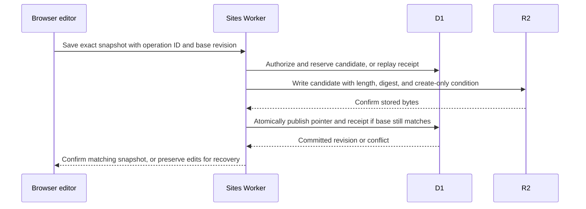

# Cloud documents with explicit Save

## Scope

[Issue #114](https://github.com/mmizutani/wordcraft/issues/114) owns acceptance criteria D1–D4. This phase adds an owner-only document library to the private Site described in [Hosted WordCraft](hosted-wordcraft.md). A person creates a document or opens a local DOCX, chooses **Save to Cloud** once, and can then reopen that document in a fresh browser. The pilot accepts DOCX up to 16 MiB (16,777,216 bytes).

Saving is explicit. Failed saves preserve edits in the open tab. The browser warns before leaving an unsaved document where its platform permits. Sharing and live rooms belong to [#115](https://github.com/mmizutani/wordcraft/issues/115). Persistent drafts across refreshes and crashes, Save as Cloud Copy, Trash, and a version-history UI are deferred.

## Responsibilities

| Component | Responsibility |
| --- | --- |
| Browser editor | Open and serialize DOCX with the existing WordCraft document I/O. Keep editing state, initiate explicit saves, and settle each response against its original snapshot. |
| Sites dispatcher | Authenticate visitors and supply the Site-scoped identity. The private Site's audience controls who can enter the app. |
| Rust Worker | Authorize each cloud operation, validate request bounds, publish revisions, and reconcile writes and cleanup. |
| D1 | Own document IDs, access, current revision pointers, operation receipts, and pending cleanup. |
| R2 | Store private DOCX bytes. A new upload has its own key, and the currently published body is immutable. |

The hosted package marks its HTML as cloud-enabled. The Rust/WASM app uses that marker to install same-origin cloud services, including the existing unload guard. Desktop, the Pages package, and the existing parent/page embedding contracts keep their respective file paths. The marker affects UI availability. Every Worker request still requires authenticated visitor identity. [Web startup](../../apps/wordcraft-web/src/web.rs) · [Sites packaging](../../packaging/sites/build.sh)

## Editor behavior

| Action or state | Behavior |
| --- | --- |
| New or local DOCX | Use the normal editor New or Browse flow. The first **Save to Cloud** creates a cloud document using the current snapshot and a confirmed name. Ordinary Save uses the local path until a cloud create succeeds. |
| File › Open › Cloud documents | List the owner's documents by last saved time. Open reads the saved bytes and installs the cloud document ID and revision from that response only after the existing DOCX import succeeds. The normal unsaved-changes guard applies when Open would replace a document. |
| Cloud-bound Save | The ribbon, shortcut, and Save Changes prompt use `file.save`. Capture the local document ID and edit revision, server document ID and base revision, operation ID, and serialized bytes. Show **Saving** while that operation is unresolved. |
| Confirmed Save | Update the cloud binding and base revision for the local document that sent the request. Clear dirty state and show **Saved** only when that document still matches the saved snapshot. Edits made during the save remain dirty. |
| Failed or stale Save | Keep the document and its edits open. For an uncertain failure, **Retry** resends the same operation and exact snapshot. For a stale revision, offer **Download Your Edits** and **Reload Latest**. Confirm before discarding edits on reload. |
| Download DOCX | From the editor, write a local copy of the current buffer using the existing serialization path. From the library, download the committed bytes. A download preserves the cloud binding and dirty state. |
| Delete | Confirm against the library entry's revision. Remove it from the list when deletion is accepted. A stale delete requires refreshing and confirming the newer revision. An already open tab keeps its buffer and can download it. Its next cloud save reports that the cloud document is gone. |

Use the existing command dispatch and optional platform service pattern. Cloud Save is a distinct typed asynchronous operation. The legacy host bridge routes both Save and export through the same callback and clears dirty state at handoff, which is insufficient for cloud commit acknowledgment. Reuse the local pending-save and navigation guards where their semantics fit. Only one cloud save per local document can be outstanding. The unsaved-changes and unload guards count an unresolved cloud save as unsaved. The Save Changes prompt waits on that operation, including a first Save to Cloud. A held-back New, Open, or Close resumes only after the matching snapshot commits and the document still has no unsaved edits. Canceling the navigation clears the held intent. Before applying a cloud Open or Reload response, check that the original navigation intent and target document still match. If the edit revision changed during the fetch, repeat the unsaved-changes confirmation before replacing the buffer. [Save dispatch](../../crates/ui-egui/src/app/commands.rs) · [Pending saves](../../crates/ui-egui/src/app/files.rs) · [Local document identity and edit revision](../../crates/engine/src/session/query.rs)

Use the same DOCX reader and writer as local file operations so preserved source markup and existing password handling follow the same rules. A password-protected document keeps its protection on cloud Save and Download. If the hosted editor cannot save the current protection mode, report the failure and keep the buffer available for local recovery.

## HTTP contract

All routes are under `/api/cloud/documents` on the Site origin. The Worker accepts `oai-authenticated-user-id` only behind the Sites dispatcher. Before enabling cloud documents, verify that the dispatcher supplies this ID independently of client headers and that all requests pass through it. The storage code receives the verified owner ID from the request handler. A personal Cloudflare deployment could supply it through its own server-side sign-in without changing the storage protocol. The Site-scoped IDs remain local to this deployment. [Phase 1 identity probe](hosted-wordcraft.md#storage-and-identity-probe) · [Sites identity and storage](https://learn.chatgpt.com/docs/sites/data-and-connections)

Reads use the D1 primary. All storage operations scope document lookups to the authenticated owner. Return `401` for missing identity and `404` for missing, foreign, or deleted documents. An owner's retry of their own deletion can reach its tombstone for cleanup. Writes also verify the exact Site origin. Document bodies, library responses, and errors use `Cache-Control: private, no-store`.

| Request | Success and conditions |
| --- | --- |
| `GET /api/cloud/documents` | `200` with up to 50 live entries and a continuation cursor. Each entry contains ID, display name, revision, byte size, and saved time. Use saved time and ID for stable ordering. |
| `POST /api/cloud/documents` | Create the first revision with a server-generated opaque ID. Return `201` with the saved entry and its strong revision ETag. The same operation retry returns the original receipt. |
| `GET /api/cloud/documents/{id}` | `200` with the current DOCX as a stream, its strong revision ETag, and an attachment filename. Read the metadata and object from the same revision. If a concurrent save retires the selected object before it can be opened, reread the current pointer once. A missing object at a still-current pointer is a storage error. |
| `PUT /api/cloud/documents/{id}` | Save a new revision when `If-Match` matches the current ETag. Return `200` with the saved entry and new ETag. Return `412` for a stale base. |
| `DELETE /api/cloud/documents/{id}` | Require `If-Match` for the initial deletion. Return `204` when active DOCX bytes are purged, or `202` when the document is hidden and cleanup is pending. Replaying the same owner-authorized delete resumes cleanup. |

Save requests carry raw bytes with the DOCX media type, a UUID `Idempotency-Key`, a positive decimal `X-WordCraft-Size`, and a hexadecimal `X-WordCraft-SHA256`. First Save also carries `X-WordCraft-Name` as percent-encoded UTF-8. Decode and validate it as a display filename. It has a bounded length, a `.docx` extension, and no path separators or control characters. Names never become object keys. An operation key is scoped to the owner. Reuse with a different target, base revision, name, length, or checksum returns `409`. A duplicate still being reconciled can return `202`. The editor retries the same snapshot and operation with backoff. For an uncertain save, the editor uses a fresh operation ID only after a definitive `operation_abandoned` response.

Require a single explicit revision precondition for an existing-document save or delete. Return `428` when missing, `400` for malformed metadata or a body that disagrees with its length or checksum, `413` for a body above the cap, `415` for another media type, and a retryable `503` for unavailable or indeterminate storage. Use stable error codes so the browser can distinguish a stale revision, an expired session, and a retryable failure. [HTTP conditional requests](https://www.rfc-editor.org/rfc/rfc9110.html#section-13.1.1)

Check the declared length before streaming. Enforce it on the actual request stream and use the existing Worker SDK's fixed-length stream support for R2. If `Content-Length` is present it must agree. Use the R2 upload checksum to verify the bytes before a revision can be published. The Worker treats the body as opaque and serves it as an attachment with `nosniff`. WordCraft's bounded DOCX reader validates the package on import and open. This keeps document parsing out of the storage Worker and avoids buffering a full upload per request in its isolate. [R2 Workers binding](https://developers.cloudflare.com/r2/api/workers/workers-api-reference/) · [Worker limits](https://developers.cloudflare.com/workers/platform/limits/)

## Revision publication and cleanup

Append a D1 migration alongside the existing `drizzle` journal. Keep the existing `DB` and `BUCKET` bindings. D1 holds two logical records:

- `cloud_documents` holds the stable document ID, Site-scoped owner ID, display name, current revision and object pointer, size, and saved time. A deleted record is hidden and retains only the information required to authorize retries and complete cleanup.
- `cloud_saves` holds the owner-scoped operation ID, target, request identity, candidate R2 key, outcome, and cleanup state. A receipt preserves the committed revision even after a later save. The ledger records each possible object key before an upload starts, so a failed Worker invocation leaves enough information to recover.

The save flow writes the body first and publishes its D1 pointer second. D1's transactional batch keeps the pointer and receipt together. The statement that records success checks that the pointer selects this operation's candidate, so a compare-and-set that matched zero rows cannot record success. A new document becomes visible in that transaction. R2 candidates use opaque, operation-scoped keys and create-only writes. An already-present candidate can be reused only after checking its length and checksum against the reservation. [D1 batch transactions](https://developers.cloudflare.com/d1/worker-api/d1-database/#batch) · [R2 consistency](https://developers.cloudflare.com/r2/reference/consistency/)

- **Concurrent saves.** Reserve the operation and grant its single upload claim with a fixed expiry in one D1 transaction. For an existing document, require a live row owned by the caller and the expected base revision in that transaction. Duplicates reconcile the outcome or receive `202`. Two operations based on the same revision can prepare separate candidates. The D1 compare-and-set publishes at most one. A stale candidate is sealed against publication and scheduled for cleanup.
- **Lost acknowledgment or interrupted upload.** Look up a retry by owner and operation ID before the base-revision check, including a first save that has only a reservation. Replay an exact committed receipt while its document is active, even if the document advanced afterward. After an upload claim expires, reconcile a matching R2 candidate through the normal D1 commit. If a candidate is absent or invalid, seal the operation as abandoned before responding with `409 operation_abandoned` and schedule cleanup. Sealing and commit are mutually exclusive D1 transitions. If the seal loses to a concurrent commit, replay the winning receipt. If the D1 result is uncertain, reread the ledger before reporting an outcome. A timeout or missing R2 object leaves open the possibility of a late upload.
- **Deletion and obsolete bytes.** Tombstone the document and seal its pending writes in one D1 transaction before purging. A deleted document's receipt cannot reopen or recreate it. After cleanup, retain a minimal tombstone for the document and the first create's owner and operation ID. This prevents a delayed POST replay from recreating the document while allowing the rest of its save metadata to be removed. Cleanup can touch an object only after a D1 transaction has sealed its candidate or retired it in the same transaction that advanced the published pointer. If an upload could still complete, replace its sealed key with a zero-byte cleanup marker and confirm the marker. The create-only condition fences a late upload. Remove the marker only when the uploader is known to have settled. Validate the marker/late-upload race in the hosted runtime before relying on it.
- **Interrupted cleanup.** Keep cleanup entries durable until confirmed. Retry a bounded batch during a repeated delete or later authenticated library activity for that owner. A `202` acknowledges removal from the live library and reports pending cleanup. A browser can be closed while cleanup is pending. The pilot's runbook must describe how the owner retries and checks the remaining work. Managed backups and recovery have their own retention. Record the verified Sites policy before inviting test documents and state any retention that the platform leaves unspecified. [D1 Time Travel](https://developers.cloudflare.com/d1/reference/time-travel/)

Storage logs use outcome codes and timings. Keep owner identifiers, file names, bytes, passwords, and authorization headers out of logs. The Phase 1 `probe` feature stays outside the editor profile.

## Verification strategy

| Claim | Narrowest evidence |
| --- | --- |
| D1. Create, import, reopen, and download | Private Sites browser test with a blank document and a DOCX fixture containing representative retained source markup. Reopen from a fresh session. Check the edited content and retained parts in the downloaded package. Compare committed download bytes with the saved object. |
| D2. Correct Save acknowledgment | Client state tests for pending, failed, wrong-document, and out-of-order receipts. Edit while Save or Open is pending and verify that the response preserves newer edits. Verify pending navigation guards and that downloading a copy leaves dirty state alone. |
| D2. Concurrency and recovery | Local workerd integration test against actual D1/R2 bindings with two writes at one base revision, duplicate operation IDs, and interruption before R2 put, after put, and after D1 commit. Exactly one concurrent revision advances. A lost receipt can be recovered without creating another revision, and an interrupted reservation can reach a terminal result. Repeat the two-tab conflict on the private Site. Verify that Download Your Edits includes the stale tab's changes and Reload Latest confirms before discarding them. |
| D3. Access and deletion | Private Sites test using two permitted accounts. Account B cannot list, open, download, save, or delete account A's document, including attempts to supply a forged identity header. Signed-out and service-only requests lack document access. Race deletion against a pending upload, verify the library hides the document, and show cleanup or its retry removes active DOCX bytes. Replay the original create after deletion and verify that it leaves the document deleted. |
| D4. Managed runtime and Pages | Signed-in Sites round trip at exactly 16 MiB, plus rejection above it and on mismatched length or checksum. Verify migrations, binding behavior, and backup-policy evidence with synthetic data. Serve the existing static build under a subpath and exercise local Open and Save. |

**Early verification.** Before connecting the UI, verify the two-account identity boundary and a full-size streamed write, conditional publication, and read against the private Site. Prove the R2 cleanup marker prevents a racing create-only upload. If the managed runtime fails any of these prerequisites, resolve the affected contract before opening the pilot to tester documents.

## Pilot operations

Build the Worker with `worker-build --release --out-dir /absolute/output/path -- --locked` from `packaging/sites/worker`. From the repository root, run `python3 packaging/sites/tests/cloud_documents.py /absolute/output/path` against Wrangler 4. The harness uses disposable local bindings. For a managed check, build and publish the private editor artifact using the [Phase 1 runbook](hosted-wordcraft.md#verify-the-deployment-boundary-first) and use synthetic data. Compare the saved version with the tested source commit and verify the migration before the first request. Roll back to the prior saved version if needed and leave the additive migration in place.

An owner can retry a delete while cleanup is pending. A successful library refresh also attempts a bounded cleanup batch. A `204` on the delete confirms removal of active document bytes. A zero-byte marker can remain when upload settlement is unknown. It contains no document data. During a synthetic deletion race, the fixed Worker log outcomes `cleanup_marker_confirmed` and `upload_fenced` distinguish a verified R2 fence from a request rejected by D1 alone.

Sites documents managed D1 and R2 storage. Its public documentation gives no fixed backup retention period for those bindings. Record any Site-specific retention information the provider supplies before accepting tester documents. [Sites data and connections](https://learn.chatgpt.com/docs/sites/data-and-connections) · [Sites administration](https://learn.chatgpt.com/docs/enterprise/sites)

## Later collaboration

The document ID and revision remain stable concepts for the next phase. When a live room owns a document, explicit Save must go through that room's ordered commit path. The hosted file API will need to respect that authority before [#115](https://github.com/mmizutani/wordcraft/issues/115) enables co-editing.
