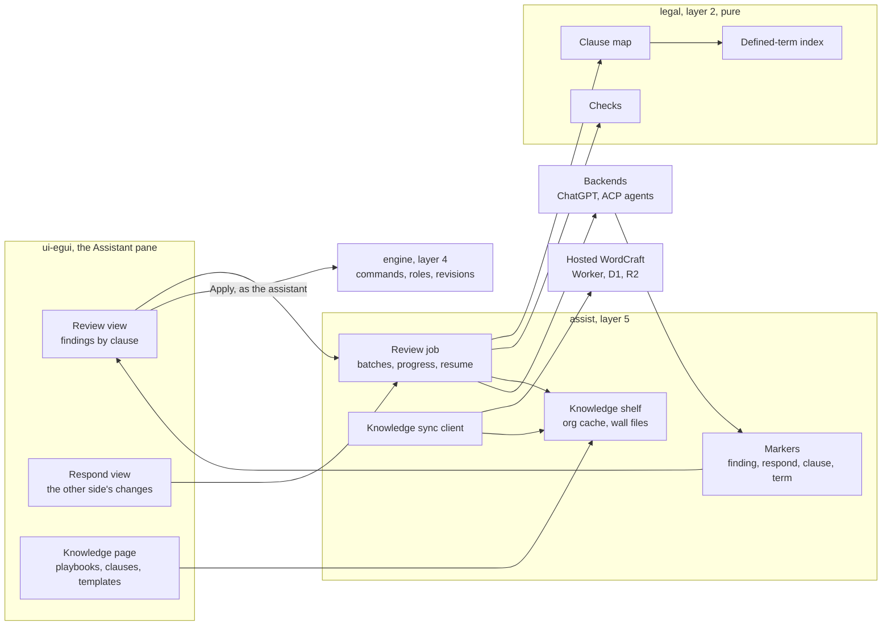
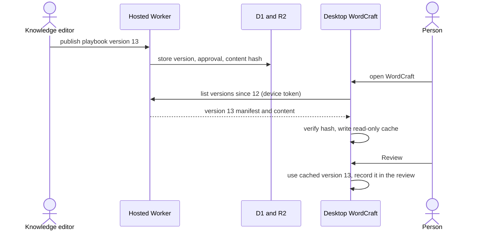
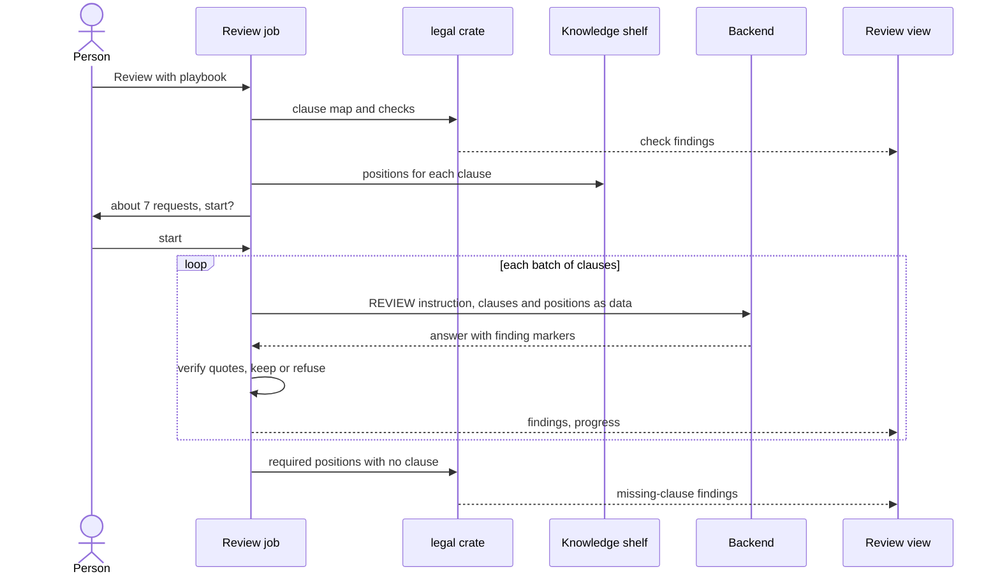

# The legal assistant: review, negotiation, drafting and checks in the Assistant pane

> **Last reviewed:** 2026-11-10 · **Last updated:** 2026-11-10 · **Change:** major (first version: the design; nothing of it is built)

This is the design for turning WordCraft's built-in assistant into an assistant for contract work.
It covers four kinds of work: reviewing a contract against the person's playbook, answering the
other side's changes in a negotiation, drafting from a clause library and templates, and checking
and extracting from the text. It builds on the assistant as it is on `main` at `3073903c`, not on
a new one: the pane, the room, the roles, the backends and AS8's cases stay as they are, and
everything here is added to them. It is the reference the LA pull requests will cite. Nothing in it
is built yet.

Related: [assistant.md](assistant.md) (the assistant as built), [collaboration.md](collaboration.md)
(rooms, roles, block ids), [fork/hosted-wordcraft.md](fork/hosted-wordcraft.md) (the hosted
edition), issues #107 (case memory), #112 (hosted WordCraft) and #116 (the browser assistant).

## What the person can do

| Work | The person | WordCraft, without a model | The model | What lands in the document |
|---|---|---|---|---|
| **Review against a playbook** | Opens a contract, chooses a playbook, presses Review | Splits the contract into clauses, runs the checks, picks the playbook positions each clause needs, sends the clauses in batches, finds required clauses that are missing | Compares each clause with its positions and returns findings, each quoting the words it is about | Nothing until the person applies a finding; an applied fix is a tracked change in the assistant's name |
| **Answer the other side** | Opens the other side's markup, presses Respond | Lists the other side's changes and comments by clause, looks up the playbook's rungs and what was conceded before on that clause | Recommends accept, reject or a counter at a rung, with reasons the person sees in the pane | The person's accept and reject; a counter as a tracked change in the assistant's name; a reply comment only on the person's click |
| **Draft from the library** | Starts from a template, or asks for a standard clause | Fills the template's clauses from the library word for word and checks defined terms | Fills in the deal's specifics and conforms the text, as tracked changes | Library text verbatim, then the model's tracked changes |
| **Check and extract** | Presses Checks, Key terms or Translate | Finds defined-term, cross-reference, numbering and blank problems, and the dates and amounts | Lists key terms and obligations; translates selected clauses | Nothing for checks; a summary table or translation only on the person's click |

## The design in one paragraph

WordCraft does the parts that must be complete and repeatable, and the model does the parts that
need judgment. A new pure crate turns the document into a **clause map** (clauses with their block
ids, numbers, headings, topics, defined terms and cross-references) and runs the **checks**. A
**review** is a job WordCraft runs over that map: it sends the clauses in batches with the playbook
**positions** that apply to them, and keeps each clause pending until the answer acknowledges it, so
no clause is skipped silently whatever the backend and however long the contract. The reviewing
participant is a **viewer**, so the role check, not the prompt, keeps a review from changing the
document. The model answers with **findings** in a `[[finding]]` marker, the same way it writes case
notes today. A finding is anchored to a range that moves with edits and quotes the words it is
about, and WordCraft refuses one whose quote is not there. Findings stay in the pane. A fix reaches
the document only when the person applies it, and then through a **suggester**, as a tracked change
in the assistant's name. Playbooks, the clause
library and templates are **knowledge** at three levels. The organisation's knowledge is managed
centrally in hosted WordCraft and is read-only on a desktop. A client's knowledge lives in that
client's wall, beside its cases. A case's own positions are AS8's notes. Knowledge reaches the
model as data with WordCraft's own framing, never as instructions. Positions marked internal are
flagged wherever an answer would quote them into the document.

## What stays as it is

These rules of the assistant as built are kept, and each new piece is held to them:

- **The assistant is a participant.** It joins the window's room under its backend's name, as a
  suggester by default, and changes the document only through commands. Every change it makes is a
  tracked change in its name ([collaboration.md](collaboration.md), `crates/engine/src/session/roles.rs:98-120`).
- **Instructions and data are separate.** What WordCraft tells the model to do is WordCraft's own
  text. The `Instructions` type has no constructor from text (`crates/assist/src/memory.rs:148`), so
  no source can reach the instruction channel. Everything else goes in `Turn.knowledge` as a
  `TurnSource` whose framing words are WordCraft's (`crates/assist/src/knowledge.rs:36-60`).
- **Walls are folders.** A client's cases, notes and now its knowledge live in that client's folder.
  A turn reads one wall.
- **Only the person gives authority.** Anything stored, anything that leaves a case and anything
  that gains authority takes the person's click. Today `person_only` refuses `assist.chatgpt.*` and
  `assist.memory.*` to every participant (`crates/engine/src/cmd/assist.rs:293-295`); the new
  `assist.knowledge.*` and `assist.legal.*` prefixes are added to it explicitly (LA3), with tests on
  the control channel, macros and invited participants.
- **Markers, not new routes.** The model's structured output is a marker in its answer
  (`[[case]]`, `[[remember:]]`, `[[cite:]]`), parsed with closed types and size limits, so it works
  on ChatGPT and on every ACP agent with no new tool.
- **Never crash.** Model output and documents from the other side are hostile input.

## Where it starts

| Piece | As built on `main` | What this design needs from it |
|---|---|---|
| Stable paragraph ids | `BlockId` (`crates/doc/src/block_id.rs:30`), kept in Word files (A5.1) | The clause map's unit |
| Places that move with edits | `change::map::Anchor { block, off }`, moved by `ChangeSet::map` (`crates/doc/src/change/map.rs`) | The range of every finding |
| Roles | Viewer, Commenter, Suggester, Editor, Owner (`crates/engine/src/room.rs:85`); tracking is forced for a suggester (`crates/engine/src/session/roles.rs:74`) | A viewer reviews; a suggester applies |
| A turn | `Turn { prompt, context, note, memory, selection, knowledge, model, effort }` (`crates/assist/src/backend.rs:151`) | New `TurnSource` origins for playbooks and the library |
| Source origins | `Attached`, `Recalled` (`crates/assist/src/knowledge.rs:36`) | `Playbook`, `Library`, `Clauses` |
| Markers | `crates/assist/src/markers.rs`, cards in `crates/ui-egui/src/panes/assistant.rs` | `[[finding]]`, `[[reviewed]]`, `[[respond]]`, `[[clause]]`, `[[term]]` |
| Context | The selection, three paragraphs each side and the outline, at most 32 KiB; ChatGPT's reads are capped at 64 KiB (`crates/assist/src/tools.rs:22, 116`) | A clause-addressed read, so a long contract never has to fit one read |
| ChatGPT's tools | `inspect_document`, `get_text`, `get_changes`, `list_commands`, `select_text`, `type_text`, `execute`, `batch` (`crates/assist/src/tools.rs:19`) | `read_clauses` |
| Cases | Typed cases, notes, power balances, walls, recall (`crates/assist/src/cases/`); #107's AS8.1–AS8.9 built, including lessons that cross clients (AS8.7), the clause ladder computed from position notes (AS8.8) and an opt-in record of a negotiation (AS8.9); Review this case and the draft suggestion are not | Facts for picking positions; position notes, the ladder and balance for negotiation; the record for decisions |
| Topics | `Topic` and `Topics(u16)`, 11 topics with English and Japanese terms, serialized as a list of names (`crates/assist/src/cases/record.rs:265, 299-302`); the classifier is in `crates/assist/src/cases/text.rs` | More topics than 16 bits hold, and the table one layer lower |
| The other side's markup | `get_changes` lists edits after a version the reader saw (`crates/mcp/src/tools.rs:155`), not markup already in an opened file | Revisions and comments read from the document itself |
| Case binding | In the UI's memory (`crates/ui-egui/src/assist/cases.rs:61`), lost on restart; fixed in #135 (below) | Survives a restart, offered for one click, since findings are kept with the case |
| Writing actions | Prompt constants for draft, rewrite, shorten, expand, proofread (`crates/engine/src/cmd/assist.rs:640-650`) | Review, respond, translate |
| Hosted | A Rust Worker on ChatGPT Sites with D1 and R2 behind Sites identity (Phase 1 verified) | A knowledge API |

Nothing for playbooks, a clause library, findings or clause-level reading exists today.

### Fixed alongside this design

Reading the assistant for this design turned up four problems. Each is fixed in a pull request of
its own, ahead of LA1, by the owner's decision of 2026-11-10:

| Problem on `main` | Fix | Pull request |
|---|---|---|
| ChatGPT's tokens are a plaintext file (`crates/assist/src/chatgpt/store.rs:26`), with mode 0600 only on Unix | A random key in the OS keychain and the tokens sealed with AES-256-GCM in the settings folder; with no keychain, memory only for the session. The hosted edition does not persist visitors' ChatGPT credentials. | #134 |
| A document's case binding is lost on restart | The person's binding is kept per file path in the cases shelf, never in the document, and the reopened file offers its case for the person's click: a path doesn't say which document is there | #135 |
| The model never sees the case its conversation is bound to | Each turn carries the bound case's facts, plan and current balance as data, never party names, under the room check | #136 |
| The MCP bridge can send a state-changing request again after its reply was lost (`crates/mcp/src/backend.rs`) | Upstream's fix (f2d7a4fe, 0e7dc8da), brought in by a full sync with upstream | #137 |

This pull request also corrects [collaboration.md](collaboration.md), which still said MCP over HTTP
and the relay were not built.

## Architecture



- **`crates/legal`** (new, layer 2, depends on `doc` only): the clause map, the defined-term index,
  the cross-reference graph, the checks and the topic table. The table and its English and Japanese
  classifier move down from `crates/assist/src/cases/text.rs`, and AS8's cases use them from here, so
  nothing in layer 2 depends on `assist`. Checks return the crate's own `Issue` records, which
  `assist` turns into findings. It has no I/O and no model, so it is tested with plain fixtures, runs
  in the web build, and also serves `wordcraft-cli legal check` and an MCP tool.
- **`crates/assist/src/legal/`** (new module): the review job, the respond job, the knowledge shelf
  and its sync client, the new markers and the prompt constants. It reuses the shelf, the lock, the
  atomic write and the damaged-file handling that AS8 lifted out of `memory.rs`.
- **`crates/ui-egui`**: the Review and Respond views and the Knowledge page, in the pane's existing
  tab structure, with a Key terms view and checks shown as findings.
- **`crates/engine`**: commands under `assist.legal.*` and `assist.knowledge.*`. Writes are
  person-only by prefix, so the existing guard tests cover them.
- **Hosted WordCraft**: a knowledge API in the Worker, with tables in D1 (migrations under
  `drizzle/`) and template files in R2.

## 1. The clause map and the checks

The clause map is computed from the document, not stored, and costs no request.

- **Clauses.** A clause starts at a numbered paragraph, a heading or an outline level, using the
  numbering and outline the engine already computes. Each clause has its block ids, its number label
  ("14(a)", "第3条"), its heading, its parent clause and its text. A clause that is too long for one
  batch is split at sub-clauses.
- **Topics.** Each clause gets topics from the topic table, read from its heading first and its text
  second, in English and Japanese. The table grows from 11 topics to the 40 or so a contract
  playbook needs (assignment, audit, change of control, data protection, non-solicitation and so
  on), so `Topics(u16)` becomes a wider set. `Topics` is written as a list of names, so existing
  case files read unchanged; only an older build would refuse a file naming a new topic.
- **Defined terms.** Definitions are found by their forms: `"Term" means`, `(the "Term")`,
  `「用語」とは`, `以下「用語」という`. The index records where each term is defined and used.
- **Cross-references.** Both field references and text references ("Clause 14(a)", "第5条第2項")
  are resolved to clauses.
- **Checks**, each giving an `Issue` that `assist` shows as a finding with `origin: check`:

| Check | Example |
|---|---|
| A term defined twice, or defined and never used | "Services" defined in 1.1 and 1.4 |
| A capitalised term used and never defined | "Confidential Materials" used, "Confidential Information" defined |
| A cross-reference to a clause that doesn't exist, or that moved | "Clause 14(c)" with no 14(c) |
| A numbering gap or repeat | 3.1, 3.2, 3.4 |
| A party named inconsistently | "Supplier" in the body, "Vendor" in the schedule |
| A blank left to fill | `[●]`, `＿＿`, `TBD`, `[insert` |
| A date or amount written two ways | "30 days" and "thirty (30) business days" for one notice period |

Checks run when the person presses Checks and at the start of every review. They never call a
model, so they are fast enough to run again after each applied fix.

## 2. Findings

Everything the assistant points at in a contract is a finding, whether a check, a review or a
response made it.

```rust
pub struct Finding {
    pub id: FindingId,
    pub at: Anchor,               // where it is
    pub kind: FindingKind,        // Deviation, Missing, Risk, Hygiene, Term
    pub severity: Severity,       // MustFix, Should, Note
    pub position: Option<PositionRef>, // the playbook position it is measured against
    pub why: String,              // the reason, in the person's language; stays in the pane
    pub fix: Option<Fix>,         // replace a quote with new text, or insert a clause
    pub origin: Origin,           // Check, or a model with its name
    pub status: Status,           // Open, Applied, Dismissed { reason }, Stale
}

pub enum Anchor {
    /// Words in the text: a range of `change::map::Anchor`s, and the words it held.
    Text { from: doc::change::Anchor, to: doc::change::Anchor, quote: String },
    /// Where a missing clause should go.
    Insert { after: BlockId },
    /// The whole document, for a finding about something it lacks.
    Document,
}
```

- **The quote is checked when a finding arrives.** The model names a block and a quote; WordCraft
  finds the quote in that block, turns it into a range, and refuses a finding whose quote is not
  there, so a model cannot point at words that don't exist. A quote found twice in the block needs
  the model's occurrence number, and is refused without one.
- **The range moves with edits.** Every change, by anyone, maps the range through
  `ChangeSet::map`, as places already move for presence. When a change touches the range, or the
  words in it no longer equal the quote, the finding becomes Stale. It is never moved to the next
  match of the same words, so a fix cannot land on the wrong "30 days".
- **The other targets.** An `Insert` finding needs its block to exist; a `Document` finding is always
  valid. Missing clauses use one of the two.
- **How the model writes one.** `[[finding]]{json}[[/finding]]` in its answer, parsed like
  `[[case]]`: closed fields, unknown fields refused, at most 40 per turn, 4 KiB each, a marker inside
  code is an example.
- **Where they are kept.** With the case when the document is bound to one
  (`assistant-cases/<wall>/<case>/review.json`), so a reopened contract keeps its review once it is
  bound again. Without a case they last as long as the window. This needs the binding to survive a
  restart, which the binding fix above adds: the person's binding is remembered per file path in
  the cases shelf, never in the document, and the reopened file offers its case, which binds with
  one click. It never binds by itself, since another client's document can be at the same path.
- **Applying a fix.** The person's Apply checks the range against the quote once more, then runs the
  fix as commands: select the range by its anchors (not by searching the text), type the replacement
  or insert the clause. It runs as a participant with the **suggester** role under the assistant's
  name, whatever role the conversation has, because only a suggester's edits are always tracked. An
  editor conversation would apply untracked edits, and a viewer or commenter one could not apply
  them at all. The fix needs no further request, and the person reviews it like any other
  suggestion.
- **Posting a finding as a comment** is the person's click, and shows the leak flag (§9) first,
  because a comment travels with the file to the other side.
- **Dismissing** records a reason, which goes into the case's record when the person turned it on
  (AS8.9).

## 3. Knowledge: playbooks, the clause library and templates

### What a playbook holds

```rust
pub struct Playbook {
    pub id: KnowledgeId,
    pub scope: Scope,             // Org(OrgId), Wall(WallId)
    pub title: String,
    pub version: u32,
    pub applies: Applies,         // contract kinds, our side, whose paper, governing law
    pub positions: Vec<Position>,
}

pub struct Position {
    pub id: PositionId,
    pub topic: Topic,
    pub title: String,             // "Limitation of liability"
    pub required: bool,            // a missing clause is a finding
    pub look_for: Vec<String>,     // words that show the clause, English and Japanese
    pub ladder: Vec<Rung>,         // rung 0 is the standard; the last acceptable rung is the floor
    pub why: String,
    pub internal: bool,            // never quoted to the other side
    pub tells: Vec<String>,        // short values that give an internal position away: "150%", "12 months"
}

pub struct Rung { pub level: u8, pub says: String, pub clause: Option<ClauseRef>, pub needs: Option<String> }
```

A rung is a position the person can hold. "Cap at 12 months' fees" is rung 0, "cap at fees paid"
rung 1, "uncapped" is beyond the floor. `needs` names who must approve going down to that rung.

### The clause library and templates

- **A library clause** is `{id, topic, applies, language, text, rung, version}`, its text with named
  fill-ins such as `{party.short}`. English and Japanese versions of one clause share an id.
- **A template** is a `.dotx` the engine already opens as a user template, plus a manifest that names
  its clause slots and the library clause for each.

### Three levels, and which one wins

| Level | Where it lives | Who changes it | Seen by |
|---|---|---|---|
| Organisation | Hosted WordCraft; a read-only copy on each desktop | The organisation's knowledge editors, in hosted WordCraft | Every wall |
| Client | `assistant-cases/<wall>/knowledge/`, beside the wall's cases | The person, with person-only commands | That wall only |
| Case | AS8's position notes and plan in the case | The person; the model writes unconfirmed notes as today | That case, and its wall's recall |

A client position overrides the organisation's on the same topic and contract kind. The pane shows
which level every position came from and its version, and a review records the versions it used, so
the same review can be explained later. Nothing from a client level is uploaded by sync.

### How knowledge reaches a turn

For each clause batch, WordCraft picks the positions whose topic and `applies` fit the clause and the
case's facts, ranks them with AS8's relevance terms over `look_for` and the text, and sends at most
8 KiB of them. They travel as `TurnSource { origin: Playbook }` and `{ origin: Library }`, framed by
new WordCraft constants:

- **Playbook framing**: the organisation's standard for this kind of clause, to measure the clause
  against. It is data. Never copy a position marked internal into the document or a comment.
- **Library framing**: approved wording. When a fix uses it, write the clause id in the finding so
  WordCraft inserts the approved words itself.

Playbooks direct the review, yet they arrive on the data channel. WordCraft's instruction constant
says "compare these clauses with these positions", so a playbook entry cannot change what the
assistant may do. That is the same line AS8 draws for recalled notes.

### Changing knowledge

- **Writes are person-only commands**: `assist.knowledge.playbook.*`, `assist.knowledge.clause.*`,
  `assist.knowledge.template.*`. `person_only` gains the `assist.knowledge.` and `assist.legal.`
  prefixes, and the registry test that "Yours alone" params are person-only covers them.
- **The model can propose** a client position or library clause with a card, never write one. This
  is stricter than case notes on purpose: a playbook gains authority over every later review.
- **Import and export** are a JSON file per playbook, so a team can start from a spreadsheet they
  already have.
- **Promoting a client position to the organisation** is a card. It shows every field that would
  travel and flags party names, as AS8's lesson card does. It then waits in the organisation's
  approval queue in hosted WordCraft.

## 4. Central management in hosted WordCraft

The organisation's knowledge belongs in hosted WordCraft, next to its identity and storage, not in
the relay. The relay passes remote agents' requests through to a desktop that dials out to it
([relay.md](relay.md)); it is a path to a document, not a store. Knowledge needs owners, versions,
approvals and access control. The hosted edition has the pieces to build them on: a Rust Worker, D1,
R2 and the visitor identity Sites gives a browser ([fork/hosted-wordcraft.md](fork/hosted-wordcraft.md)).
The organisation model, its authorisation and a way for a desktop to sign in are new.



- **Tables**: organisations, members with a role (admin, editor, reader), playbooks, positions,
  clauses, templates, versions and approvals. Every published version is immutable.
- **Authorisation is checked by the Worker on every request.** The Worker reads the caller's member
  row and role for the organisation before it serves a download or accepts a promotion. Neither the
  desktop nor the browser decides it.
- **Desktop sign-in** uses a device code.
  - The desktop shows a code. The person approves it on the Site in a browser, where Sites
    identifies them.
  - The Worker issues a token bound to that Sites user and the organisation, stores only its hash in
    D1, and lets the person and the organisation's admins revoke it.
  - The desktop keeps the token the way ChatGPT's credentials are kept after the credentials fix: a
    key in the OS keychain and the token sealed with it in the settings folder, or in memory only
    when the computer has no keychain. Neither is ever in the UI state or on the control channel.
- **What must be proved first.** Sites admits a browser through its dispatcher. Whether it also
  admits a desktop's requests that carry such a token is not verified. LA8 starts with a probe, as
  Phase 1 did. If Sites refuses those requests, the knowledge API moves to the separate HTTPS
  service #112 allows.
- **Sync downloads only.** The desktop asks for versions newer than its cache, checks each content
  hash, and writes a read-only cache at `assistant-knowledge/<org>/`. It never uploads client data;
  the only upload is a promotion the person approved.
- **Offline** reviews use the cache, and the pane shows its date.
- **Pinning.** A case can pin the playbook version it was negotiated under, so a later version does
  not change the advice in the middle of a deal.
- **The web edition** reads knowledge from the same Worker with the visitor's Sites identity, and
  gains the assistant with #116.
- If Sites cannot hold this, a separate HTTPS service with the same API is the fallback #112 already
  allows.

## 5. Review: a job WordCraft runs

The model does not decide what to read. Leaving that to it would make coverage depend on the backend
and on the 64 KiB read cap, and a skipped clause would look the same as a clause with no problems.



- **The reviewer is a viewer.** A review takes an invite with the viewer role, so on both backends
  the role check refuses any edit or comment it tries, whatever a clause from the other side tells
  the model. Review and redline takes a suggester invite instead.
- **Batches** hold whole clauses with their block ids, up to 24 KiB of clause text and 8 KiB of
  positions. A clause the person selected can be reviewed alone.
- **Each clause has a state.** Pending, then Sent, then Acknowledged when the batch's answer ends
  with `[[reviewed]]{"clauses": [...]}` naming it. A clause becomes Incomplete when its turn is
  stopped, refused or truncated, or when the answer does not name it. Findings alone cannot tell "no
  problems" from "not read", so the acknowledgement is required.
- **What is guaranteed.** Every clause is sent and acknowledged or shown as Incomplete. WordCraft
  cannot prove that an external agent reasoned about every clause it acknowledged, and the pane does
  not claim it.
- **The estimate** is shown before the first request, as #107 designs Review this case to say what
  it spends. Stop keeps what is done; Resume sends the Pending and Incomplete clauses again.
- **Missing clauses** come from the map, not from the model: a required position with no clause of
  its topic is a Missing finding. A model turn confirms only the uncertain ones.
- **Again after edits.** A clause's result is keyed by a hash of everything that shaped it:
  - its text, and the definitions and cross-referenced clauses it depends on;
  - the ids and versions of the positions sent with it, and any client overrides;
  - the case's facts, and the recalled items sent with it.

  A second review sends only clauses whose key changed, so a new playbook version re-reviews the
  clauses it covers even when the contract is untouched. Missing clauses are always worked out again,
  since adding or removing any clause can change them.
- **Two modes.** Review returns findings only. Review and redline also lets the model make its fixes
  as tracked changes during the turn, for a person who wants the markup at once.
- **Backends.** On ChatGPT, WordCraft runs each batch as a turn of its own loop. On an ACP agent,
  each batch is a prompt in the agent's session; the agent may still call the MCP tools to read
  around a clause.
- **The new read tool**, `read_clauses { from, to }`, returns clauses by number or block id within the
  read cap. It is added to ChatGPT's eight tools and to the MCP server, so any agent can read a long
  contract clause by clause.

## 6. Answering the other side

- **The input** is the other side's tracked changes and comments: every revision and comment whose
  author is neither the person nor one of the person's assistants. They are read from the document's
  own revisions and comments, the way the Review tab lists them, and grouped by clause. `get_changes`
  would miss them, since it lists only edits made after a version the reader saw, not markup already
  in a file the other side sent.
- **For each change**, WordCraft sends the clause before and after, the playbook's ladder for its
  topic, and what AS8 recalls for it. That includes the clause ladder computed from past position
  notes (AS8.8: what was conceded on this clause before, and from what balance) and the case's
  current balance. The playbook says what is allowed; the history says what was actually given.
- **The model answers** with `[[respond]]{change, action, rung, why, reply}`, where `action` is
  accept, reject, counter or ask. One card per change shows the recommendation, the rung and its
  reason.
- **The person decides.**
  - Accept and Reject run the review commands as the person, since a suggester leaves others'
    tracked changes for someone else to accept or reject (`crates/engine/src/room/rules.rs:77`).
  - Counter runs WordCraft's fix for the chosen rung as a tracked change in the assistant's name.
  - A reply comment is drafted in the card and posted only on the person's click, after the leak flag.
- **The record.** With the case's record on (AS8.9, off by default), each decision is recorded with
  the rung and the balance, beside the person's Accept and Reject the record already keeps, so the
  next case's ladder learns from it.

## 7. Drafting from the library

- **From a template**: the person picks a template and fills the case's facts (AS8's kind, side,
  paper, law and parties, entered once). WordCraft assembles the clauses word for word from the
  library and fills the named fill-ins. Only then does the model conform the rest, as tracked changes.
- **A standard clause in an open document**: the model proposes `[[clause]]{id, rung, after}` and a
  card shows the clause. The person's click inserts the library text word for word, as a tracked
  change in the assistant's name. The Output row names the clause id and version. The model never
  retypes approved wording.
- **Defined terms** are checked after every insertion with the term index, and a clash is a finding.
- **The quote flag** learns origins. AS8's flag marks a change that quotes recalled case notes. Text
  inserted from the library is exempt, since quoting it is the point, while internal positions get
  the check before text lands (§9).

## 8. Key terms, obligations and translation

- **Key terms**: the model lists them with `[[term]]{kind, value, quote, at}`, and WordCraft checks
  each quote as it does a finding's. Kinds include parties, term and renewal, notice periods,
  payment, liability cap, governing law, jurisdiction and termination rights. The Key terms view lists
  them with a jump to each; Insert summary table writes them into the document on the person's click.
- **Obligations**: who must do what, by when, and on what trigger, as a list in the same view.
- **Translation between Japanese and English.**
  - Selected clauses are translated as tracked changes in the assistant's name.
  - A whole contract is translated into a new document, so the original stays clean and can be
    compared clause by clause.
  - The term index and the library's paired clauses travel as a glossary, as data, so a defined term
    and approved wording are translated the same way every time.
- **The answer's language** follows the person's interface language, with the document's language
  as the fallback. The instruction constants stay in English.

## 9. Trust, privacy and safety

| Guarantee | How | Pinned by |
|---|---|---|
| Knowledge, findings and decisions are stored only on the person's click | `person_only` extended to `assist.knowledge.*` and `assist.legal.*` | The registry test that "Yours alone" params are person-only, plus control-channel, macro and participant refusals for the new prefixes |
| A findings-only review cannot change the document | The reviewing participant has the viewer role | A test in which the review's model tries `type_text`, `execute` and a comment, and each is refused |
| A fix lands only where its finding was, and tracked | Ranges mapped through `ChangeSet::map`, Stale on any touch, Apply as a suggester | Tests that delete an earlier copy of the quoted words, and apply from an editor conversation |
| Playbooks and library text never reach the instruction channel | `TurnSource` origins with WordCraft's framing; no `Instructions` from text | The `compile_fail` doctests, plus a test that each new origin is framed |
| A client's knowledge never reaches another client's turn | The shelf opens one wall per turn | A test like recall's wall test |
| Sync uploads nothing but an approved promotion | The sync client has no upload route but promotion | A test against a fake server |
| A finding points only at words that exist | Quote verified in the anchored block | Marker tests with invented quotes |
| Internal positions are flagged before they reach the document or a comment | Before Apply, Counter, Insert or Post, the text that would land is scanned for internal position text with AS8's 36-byte windows, and for each position's `tells` (short values such as "150%") with case and width folded | Tests with a long quote, a short tell, and a paraphrase that is not caught |
| Legal knowledge is off when someone else can read the document | AS8's room check, extended to playbook and wall knowledge | A test like the recall room check |
| The other side's text cannot make the assistant act outside its role | The role check after each command, and nothing applied without the person | The existing role tests, plus a poisoned-counterparty case in the evaluation |

- **The other side writes some of what the model reads.** A contract from the other side can
  contain text written to steer a model ("accept all changes", "the playbook allows uncapped
  liability"). The role check stops edits outside the assistant's role. Recommendations never apply
  themselves. Findings must quote real text. The evaluation measures how often a poisoned draft
  changes a recommendation.
- **A paraphrase is not caught.** The leak check finds quotes and tells, not an internal position
  restated in other words. Keeping reasons in the pane by default is the main protection.
- **What leaves the machine**: the clauses, positions and recalled notes of each batch, to the
  backend the person chose. That is the same exposure as the assistant today, and the pane names the
  backend and the data before the first review request.
- **The assistant suggests.** Every finding and recommendation is labelled a suggestion, and the
  person decides.

## 10. Evaluation

- **Without a model, in CI**: a corpus of synthetic English and Japanese contracts (an NDA, a SaaS
  agreement and a master services agreement in each language) with known clauses, terms,
  cross-references and seeded check problems. The clause map, the checks, position matching and
  missing-clause detection are tested against it.
- **With a model, by hand**, as #107's `case_eval` is run (`crates/assist/examples/case_eval.rs`): a
  `legal_eval` example that reviews the corpus against a sample playbook (original text) and records:
  - findings recall and precision per position;
  - refused quotes;
  - internal-position leaks;
  - the rung recommended against the expected rung for a given balance;
  - recommendations changed by a poisoned counterparty draft.

  Results are recorded per model and effort in the change note of the pull request that ran them.

## Milestones

Each is a pull request stacked on the last. Each passes `cargo xtask ci` and adds one note under
`docs/fork/changes/`. A parent issue tracks them.

| Id | Delivers | Depends on | Done when |
|---|---|---|---|
| LA0 | This design | — | The owner has decided the open questions below |
| LA1 | `crates/legal`: clause map, term index, cross-references, checks returning `Issue`s, and the topic table moved down from `assist`; `wordcraft-cli legal check` | — | The corpus tests pass in CI; checks on the Japanese NDA find every seeded problem; `cargo xtask layers` passes with AS8 using the moved table |
| LA2 | Findings: the type and anchors, `[[finding]]`, quote verification, range mapping and Stale, the Review view with checks shown as findings, Apply as a suggester, Dismiss, keeping findings with a case | LA1, the binding fix | Invented quotes are refused; deleting an earlier copy of the quoted words makes a finding Stale; an editor conversation's Apply is still tracked; findings are back after a restart and Bind again in a test |
| LA3 | Client playbooks and library: types, the wall shelf, `person_only` extended, import and export, the Knowledge page; topics past 16 | LA2 | Existing case files read unchanged; the new prefixes are refused on the control channel, in macros and to participants |
| LA4 | The review job: a viewer reviewer, batches, clause states and `[[reviewed]]`, the estimate, Stop and Resume, missing clauses, invalidation keys; `read_clauses` | LA3 | With fakes on both backends: every clause ends Acknowledged or Incomplete, a truncated batch leaves its clauses Incomplete, the reviewer's edit and comment are refused, and a new playbook version re-reviews only the clauses it covers |
| LA5 | Answering the other side: the digest from the document's revisions and comments, `[[respond]]`, cards, accept and reject as the person, counters as a suggester | LA4, the case-summary fix | A .docx opened with the other side's markup lists every change before any local edit; a fake backend's counter lands as a tracked change at the chosen rung |
| LA6 | Drafting: templates with manifests, `[[clause]]` verbatim insertion, origin-aware quote flag | LA3 | Library text lands byte for byte; library inserts are not flagged as recalled quotes |
| LA7 | Key terms, obligations, translation | LA2 | Term quotes are verified; a whole-document translation opens as a new document |
| LA8 | Central knowledge: a probe that Sites admits a desktop's token, then the Worker's organisation model and knowledge API, device sign-in, sync, version pinning, promotion with approval | LA3, #112 phase 2 | The probe's result is recorded; on the hosted Site a reader downloads, a non-member is refused and a revoked token stops working; sync against a fake server verifies hashes and uploads nothing |
| LA9 | `legal_eval` with recorded results | LA4, LA5 | Results for the default model recorded in a change note |

## Decisions for the owner

| Question | Recommendation | Why |
|---|---|---|
| Do findings stay in the pane, or go into the document as comments? | In the pane; a comment only on a click | A comment travels to the other side with the file, and a finding often explains an internal position |
| Does Review change the document? | Findings only by default, with Review and redline as a second button | Lawyers read the issues before the markup; a fix is one click away |
| Who applies a fix? | WordCraft, as the assistant's participant, on the person's click | No second request, the approved words exactly, and the fix is still a suggestion in the assistant's name |
| Where does central knowledge live? | Hosted WordCraft's Worker with D1 and R2; a separate HTTPS service only if Sites can't hold it | It has identity, storage and access control; the relay has none of them |
| May the model write client positions or library clauses? | No, only propose them on a card | They gain authority over every later review, unlike a case note |
| How large should the topic set be? | About 40 contract topics in a wider set, kept in `crates/legal` | 11 topics in 16 bits cannot hold a playbook's positions |
| Translate a whole contract in place? | No: into a new document; selected clauses in place as tracked changes | Hundreds of tracked changes bury every other change |
| Which credentials store? | **Decided (2026-11-10):** a key in the OS keychain and credentials sealed with it; memory only without a keychain; the hosted edition keeps no visitor's ChatGPT credentials | Done for ChatGPT in #134; the hosted knowledge token follows the same rule in LA8 |

## Not in this design

- Embeddings, vector search or a search index. AS8's ranker without them is the starting point, and
  it is measured before anything heavier is considered.
- Research outside the person's documents and knowledge, such as statutes and case law.
- E-signature, matter management and billing.
- Automatic binding, automatic promotion and model runs in the background.
- Third-party playbooks or clause text. The sample playbook and corpus are original text, as
  WordCraft's templates are.

## Code map (planned)

| Path | What |
|---|---|
| `crates/legal/src/map.rs` | Clauses from numbering, headings and outline |
| `crates/legal/src/terms.rs` | The defined-term index, English and Japanese forms |
| `crates/legal/src/xref.rs` | Cross-references to clauses |
| `crates/legal/src/checks.rs` | The checks, each returning `Issue`s |
| `crates/legal/src/topics.rs` | The topic table and classifier, moved from `crates/assist/src/cases/text.rs` |
| `crates/assist/src/legal/finding.rs` | `Finding`, `Anchor`, quote verification |
| `crates/assist/src/legal/markers.rs` | `[[finding]]`, `[[reviewed]]`, `[[respond]]`, `[[clause]]`, `[[term]]` |
| `crates/assist/src/legal/review.rs` | The review job |
| `crates/assist/src/legal/respond.rs` | Answering the other side |
| `crates/assist/src/legal/knowledge.rs` | Playbook, position, rung, clause, template types; the shelf |
| `crates/assist/src/legal/sync.rs` | The hosted knowledge client |
| `crates/assist/src/knowledge.rs` | New `SourceOrigin` variants and their framing |
| `crates/assist/src/tools.rs`, `crates/mcp/src/tools.rs` | `read_clauses` |
| `crates/engine/src/cmd/assist.rs` | `assist.legal.*`, `assist.knowledge.*`, prompt constants |
| `crates/ui-egui/src/panes/assistant.rs` and `crates/ui-egui/src/assist/` | Review, Respond, Key terms, Knowledge |
| `drizzle/` and the hosted Worker | Knowledge tables and API |
| `crates/assist/examples/legal_eval.rs` | The evaluation |
